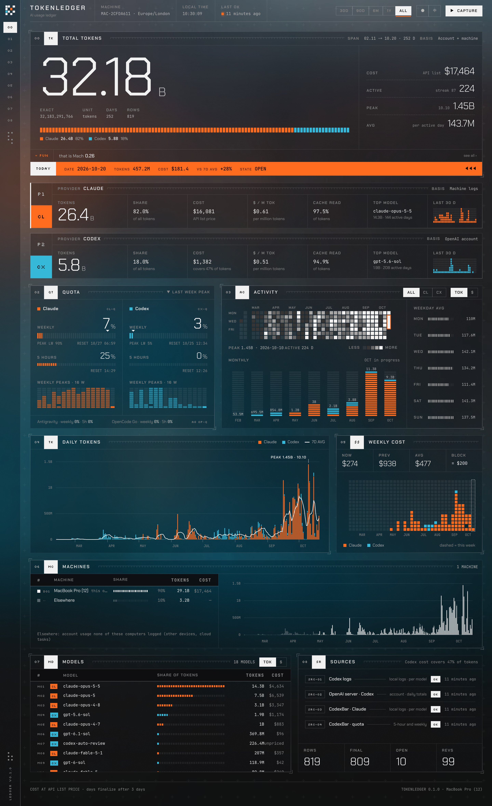
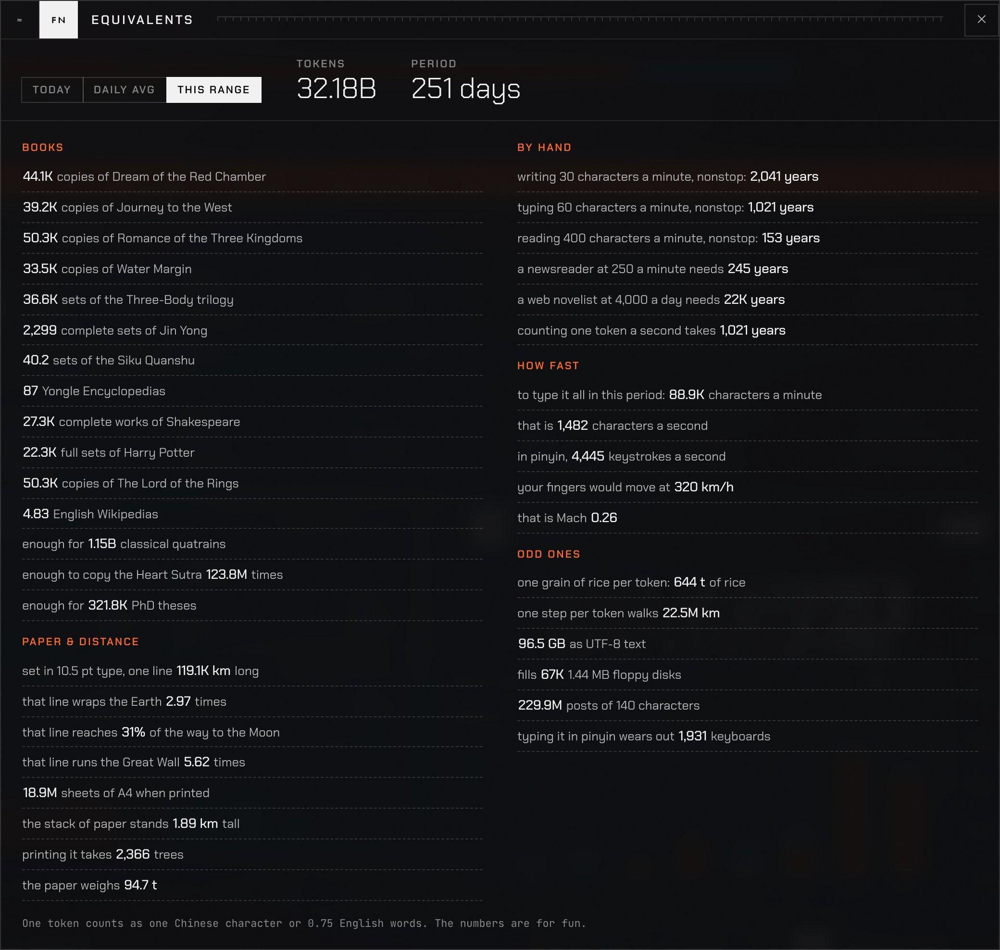

<p align="center">
  <picture>
    <source media="(prefers-color-scheme: dark)" srcset="docs/images/logo-dark.svg">
    
  </picture>
</p>

<h1 align="center">TokenLedger</h1>

<p align="center">
  An append-only ledger of your AI coding usage: Claude, Codex and Antigravity tokens and their API list-price cost, kept on your own computers for good. One Mac, or a mix of Macs, Windows PCs and Linux machines in one ledger.
</p>

<p align="center">
  <b>English</b> · <a href="README.zh-CN.md">简体中文</a>
</p>



## Why

Claude Code deletes its session logs after 30 days, Codex logs get cleaned up, and tools that read them can change how they count. TokenLedger copies the daily numbers into a local SQLite ledger. Each day stays open for three days, then it is final: whatever happens to the logs later, the history stays as it was. When a source later reports something different for a final day, the ledger records it as a revision and keeps its own value.

It comes with a local web dashboard and an MCP server, so you can also ask Claude about your usage.

## Features

- **Daily tokens and cost** per provider and per model, with cache reads, cache writes, input and output kept apart
- **Account-wide Codex totals** from OpenAI's servers (all devices), next to the per-request detail from each machine's logs
- **Quota history**: 5-hour and weekly limit usage for Claude and Codex, with weekly peaks
- **A dashboard** with daily and monthly charts, an activity heatmap, weekly cost, model breakdown and source health, in English and Chinese, light and dark
- **Several machines**: macOS, Windows and Linux share one ledger through your own Cloudflare deployment, and the dashboard shows how much each machine used. The same dashboard is on the web, behind a passkey sign-in ([docs/MULTI_MACHINE.md](docs/MULTI_MACHINE.md))
- **Fun equivalents**: your tokens as copies of *Dream of the Red Chamber*, laps around the Earth, keyboards worn out, and more



## Requirements

| What | Why | Install |
|---|---|---|
| macOS, Windows or Linux | | |
| [CodexBar](https://github.com/steipete/CodexBar) (Mac) | On a Mac: Claude and Antigravity usage, the model price table, quota history. The app also installs the `codexbar` command line tool. Open it once so it fills its price cache. Windows and Linux read Claude's logs directly instead | `brew install --cask codexbar` |
| Codex (optional) | Codex usage. Logs are read from `~/.codex`; account totals come from the Codex CLI bundled with the ChatGPT app, the standalone or npm install, or `codex` on your PATH | ChatGPT app, or `npm i -g @openai/codex` |
| Python 3.13+ | Backend | `brew install python@3.13` · `winget install Python.Python.3.13` · your package manager |
| uv | Python environment | `brew install uv` · `winget install astral-sh.uv` · `curl -LsSf https://astral.sh/uv/install.sh \| sh` |
| Node.js | Builds the dashboard | `brew install node` · `winget install OpenJS.NodeJS.LTS` · your package manager |
| A Cloudflare account with a domain (optional) | Several machines and the web dashboard; the free plan is enough | [cloudflare.com](https://www.cloudflare.com) |

Everything runs on your own machines. Network requests: the Codex CLI asking OpenAI for your account's daily totals (the same request the Codex app makes); on machines without CodexBar, the public price list from models.dev, at most once a day; and, with sync set up, your own cloud ledger.

## Quick start

```bash
git clone https://github.com/DongkunXu/TokenLedger.git
cd TokenLedger
scripts/tokenledger.sh capture
scripts/dashboard.sh open
```

On Windows, in PowerShell (if scripts are blocked, run them as `powershell -ExecutionPolicy Bypass -File scripts\tokenledger.ps1 capture`):

```powershell
.\scripts\tokenledger.ps1 capture
.\scripts\dashboard.ps1 open
```

The first capture creates `data/` with the ledger and your settings, and the first `open` builds the dashboard and opens http://127.0.0.1:8765/. Later, press **Capture** on the dashboard or run `scripts/tokenledger.sh capture` again.

### How often to capture

Accuracy does not depend on how often you capture, as long as the logs are still there when you do. Once every week or two is enough. Capture before you delete Claude or Codex conversations, and keep in mind that Claude Code removes session logs after 30 days.

### Use it from Claude (MCP)

```bash
claude mcp add tokenledger --scope user -- "$PWD/scripts/mcp.sh"
```

Then ask things like "how many tokens did I use last week", "capture now" or "open the dashboard".

## Several machines

Every machine keeps capturing into its own ledger and shares it through a **cloud ledger** you deploy once on your own Cloudflare account (the free plan is enough). Each machine merges what the others share, so every dashboard shows all machines, and the cloud serves the same dashboard on the web after a passkey sign-in.

Once, on any machine (a domain on your Cloudflare account; see [docs/MULTI_MACHINE.md](docs/MULTI_MACHINE.md)):

```bash
scripts/cloud.sh login                       # Cloudflare sign-in, deploy rights only
scripts/cloud.sh deploy tokens.example.com   # prints a link to create your account with a passkey
```

On every machine:

```bash
scripts/tokenledger.sh sync login https://tokens.example.com   # approve the machine in the browser
scripts/install-agent.sh                                       # capture and sync twice a day (Windows: scripts\install-agent.ps1)
```

Each machine gets its own token; remove one in the web dashboard's account menu and it loses access at once. Merging rules, security, and what is and isn't counted (Claude cloud sessions, teleport, Remote Control): [docs/MULTI_MACHINE.md](docs/MULTI_MACHINE.md).

## The dashboard server

| Command | What it does |
|---|---|
| `scripts/dashboard.sh start` | Start in the background (does nothing when already running) |
| `scripts/dashboard.sh open` | Start if needed and open it in the browser |
| `scripts/dashboard.sh stop` | Stop |
| `scripts/dashboard.sh restart` | Restart; needed after backend code changes |
| `scripts/dashboard.sh status` | Whether it runs, its address and uptime |
| `scripts/dashboard.sh logs` | Log of the current (or last) run |
| `scripts/dashboard.sh run` | Run in this terminal instead; Ctrl+C stops it |

The server is detached from the terminal that started it and keeps running until you stop it: `stop` or `restart`, Ctrl+C in `run` mode, or logging out or shutting down. Each reason is written to the log. While the Mac sleeps it pauses, and it carries on after wake. It listens on 127.0.0.1 only. When the machine is signed in to a cloud ledger, the server syncs with it every 10 minutes.

The header shows when every source last succeeded. When a source fails, the header shows a red notice until that source succeeds again, and the Sources panel shows the error.

## Other commands

| Command | What it does |
|---|---|
| `scripts/tokenledger.sh capture` | Capture now |
| `scripts/tokenledger.sh status` | Ledger overview, recent captures and failures |
| `scripts/tokenledger.sh accept <id>` | Adopt a source's new value for a final day (see below) |
| `scripts/tokenledger.sh backfill --dry-run` | Preview a backfill from old CodexBar caches copied into `data/legacy/` |
| `scripts/test.sh [--cloud]` | Backend tests and type checks; `--cloud` also runs the cloud ledger end to end locally |
| `scripts/build.sh` | Build the dashboard |
| `scripts/clean.sh` | Remove build output and dependencies; ledger data stays |
| `scripts/install-agent.sh` | Scheduled capture at 09:00 and 21:00: launchd on macOS (blocked by macOS when the project lives in `~/Documents`), a systemd user timer on Linux |
| `scripts/uninstall-agent.sh` | Remove the scheduled capture |
| `scripts/tokenledger.sh sync login <url>\|now\|status\|logout` | Several machines: sign this machine in, sync now, last outcome, sign out |
| `scripts/cloud.sh login\|deploy\|setup-code\|recover <name>\|status\|dev` | The cloud ledger: deploy and update it, account links, run it locally |
| `scripts\*.ps1` | Windows: `tokenledger.ps1`, `dashboard.ps1`, `build.ps1`, `install-agent.ps1 [-Remove]` (Task Scheduler) |
| `scripts/screenshots.py`, `scripts/grade-background.py` | Retake the README screenshots, regrade the background photo (usage at the top of each file) |

## Data sources

| Source | Provides | Scope |
|---|---|---|
| `codexbar cost` (Mac) | Claude and Antigravity tokens and list-price cost per day and model | This machine's logs |
| Claude Code logs (`claude-logs`) | Claude tokens and list-price cost per day and model, read with CodexBar's rules; used where CodexBar is not installed (Windows, Linux) | This machine's logs, every Claude folder including WSL |
| Codex logs (`~/.codex/sessions`) | Codex tokens and list-price cost per day and model, each request counted once | This machine, every Codex folder including WSL |
| Codex server (`account/usage/read` via `codex app-server`) | Daily token totals | Your whole OpenAI account; several accounts are added up, each once |
| CodexBar quota history | 5-hour and weekly limit percentages | Your accounts |

For Codex, the dashboard prefers the account-wide totals. The server lags half a day to a day, so for days still open it takes whichever of the server and the machines' logs is larger. Cost only comes from the machines' per-request detail; the Sources panel shows how much of the tokens it covers.

## Settling rules

- Day D is *open* on D, D+1 and D+2; every capture overwrites it
- The first capture after that settles it: if the source's total did not shrink, the ledger takes the source's numbers and freezes the day; if it shrank or the day is gone, the ledger keeps its own numbers and records a revision
- After that the numbers are fixed; a different value from a source is only recorded as a revision
- If a revision turns out to be a real correction by the source, `accept` adopts it and keeps the old value on record

## Settings

`data/settings.json` is created on first use:

| Key | Default |
|---|---|
| `timezone` | CodexBar's day timezone if set, else this machine's timezone. Days are bucketed in it, and it must match CodexBar's. All machines of one ledger use the same one |
| `grace_days` | 3 |
| `machine` | An id and label for this machine |
| `wsl` | Windows only: read the logs inside WSL distributions: `all` (default; starts a stopped distribution to read it), `running`, or `off` |

Changing the timezone after days have been settled makes old and new days disagree at midnight, so set it before your first capture if the default is wrong.

## Where things live

| What | Where | Cleaned by |
|---|---|---|
| Ledger, raw capture archive, settings | `data/` | You |
| Python env, uv/npm caches, temp files | `backend/.venv`, `.build/` | `scripts/clean.sh` |
| Frontend and cloud dependencies, the build | `frontend/node_modules`, `frontend/dist`, `cloud/node_modules` | `scripts/clean.sh` |
| Dashboard state and log (last run only) | `.build/run/` | Removed on exit; `scripts/clean.sh` |
| Cloud sign-in (this machine's device token) and the last sync | `data/sync.json`, `data/sync-state.json` | `tokenledger sync logout` |
| Your cloud deployment (domain, database id) | `data/cloud.json` | You |
| Cloudflare sign-in of `scripts/cloud.sh` | `.build/wrangler/` | `scripts/clean.sh` |
| Price list (machines without CodexBar) | `data/cache/models-dev-v1.json` | You |
| Scheduled capture | macOS: `~/Library/LaunchAgents/io.github.dongkunxu.tokenledger.capture.plist`; Linux: `~/.config/systemd/user/tokenledger-capture.*`; Windows: task "TokenLedger capture" | `scripts/uninstall-agent.sh`, `install-agent.ps1 -Remove` |

A capture takes about 2 seconds and archives about 16 KB of raw output.

```
backend/    Python: ledger, sources, API, MCP, command line
frontend/   React dashboard (charts are hand-written SVG), local and in the cloud
cloud/      The cloud ledger: a Cloudflare Worker and its D1 schema
scripts/    Build, run and test scripts (caches stay inside the project)
data/       Your ledger (not in git)
docs/       Architecture notes, multi-machine design, images
research/   The data source investigation the design is based on
```

Architecture, data model and API: [docs/ARCHITECTURE.md](docs/ARCHITECTURE.md). Several machines: [docs/MULTI_MACHINE.md](docs/MULTI_MACHINE.md).

## Credits

- [CodexBar](https://github.com/steipete/CodexBar) by Peter Steinberger, which does the hard work of reading Claude's logs and pricing them
- Fonts: [Chakra Petch](https://fonts.google.com/specimen/Chakra+Petch), [JetBrains Mono](https://www.jetbrains.com/lp/mono/) and [Silkscreen](https://fonts.google.com/specimen/Silkscreen), via Fontsource (SIL Open Font License)
- Background: a colour-graded photo by Mohammad Alizade on [Unsplash](https://unsplash.com/photos/XgeZu2jBaVI)

Not affiliated with Anthropic, OpenAI or Google. Costs are estimates at API list prices; subscription plans are billed differently.

## License

[MIT](LICENSE)
