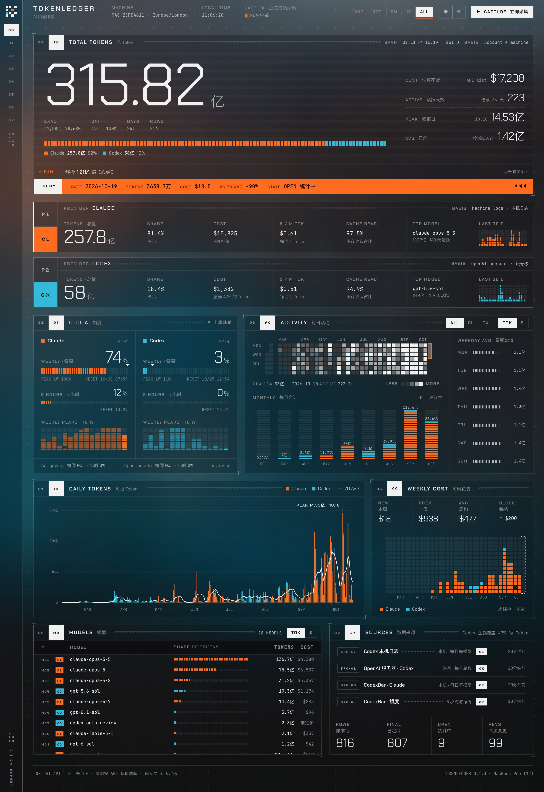
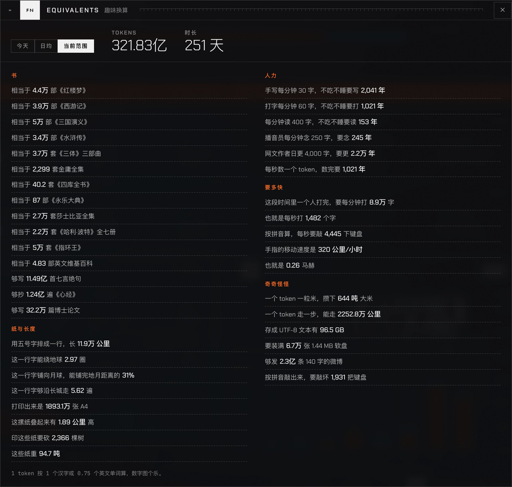

<p align="center">
  <picture>
    <source media="(prefers-color-scheme: dark)" srcset="docs/images/logo-dark.svg">
    
  </picture>
</p>

<h1 align="center">TokenLedger</h1>

<p align="center">
  一本只增不减的 AI 编程用量账本：Claude、Codex、Antigravity 的 token 数和按 API 标价估算的花费，长期保存在你自己的电脑上。一台 Mac 可以用，几台 Mac、Windows、Linux 电脑合用一本账本也可以。
</p>

<p align="center">
  <a href="README.md">English</a> · <b>简体中文</b>
</p>



## 为什么做这个

Claude Code 的会话日志 30 天后会被自动删除，Codex 的日志也会被清理，读取日志的工具还可能改变计数方式。TokenLedger 把每天的数字记进本地的 SQLite 账本。每一天在三天内都还在统计中，之后就定稿：日志后来怎么变，账本里的历史都保持原样。来源对已定稿的日子给出不同的数字时，账本记一条"来源变更"，数值保持不变。

配套一个本地网页看板和一个 MCP 接口，也可以直接问 Claude 你的用量。

## 功能

- **每天的 token 和花费**：按平台、按模型，缓存读取、缓存写入、输入、输出分开记
- **Codex 账号级总数**：来自 OpenAI 服务器（所有设备），和各台电脑日志里的逐请求明细并列
- **额度历史**：Claude 和 Codex 的 5 小时、每周额度使用比例，以及每周峰值
- **看板**：每日和每月图表、活跃热力图、每周花费、模型排行、数据来源状态；中英文界面，亮色暗色主题
- **多台电脑**：macOS、Windows、Linux 都能用。一台电脑做中心（hub）保存合并后的账本，其他电脑在局域网里自动找到它，把用量加密推送过去（[docs/MULTI_MACHINE.md](docs/MULTI_MACHINE.md)，英文）
- **趣味换算**：你的 token 相当于几部《红楼梦》、能绕地球几圈、要敲坏几把键盘等等



## 前置依赖

| 依赖 | 用途 | 安装 |
|---|---|---|
| macOS、Windows 或 Linux | | |
| [CodexBar](https://github.com/steipete/CodexBar)（Mac） | 在 Mac 上提供 Claude、Antigravity 用量，模型价格表，额度历史。App 会同时装好 `codexbar` 命令行工具。装好后打开一次，让它生成价格缓存。Windows 和 Linux 直接读取 Claude 的日志 | `brew install --cask codexbar` |
| Codex（可选） | Codex 用量。日志从 `~/.codex` 读取；账号总数通过 ChatGPT App 自带、独立安装或 npm 安装的 Codex CLI 获取，都没有时用 PATH 里的 `codex` | ChatGPT App，或 `npm i -g @openai/codex` |
| Python 3.13+ | 后端 | `brew install python@3.13` · `winget install Python.Python.3.13` · 系统的包管理器 |
| uv | Python 环境 | `brew install uv` · `winget install astral-sh.uv` · `curl -LsSf https://astral.sh/uv/install.sh \| sh` |
| Node.js | 构建看板 | `brew install node` · `winget install OpenJS.NodeJS.LTS` · 系统的包管理器 |

所有数据都在你自己的电脑上处理。会发出的网络请求：Codex CLI 向 OpenAI 查询你账号每天的总用量（和 Codex App 自己发的请求一样）；没有 CodexBar 的电脑每天最多一次从 models.dev 下载公开的价格表；设置了同步时，推送到你自己的中心。

## 快速开始

```bash
git clone https://github.com/DongkunXu/TokenLedger.git
cd TokenLedger
scripts/tokenledger.sh capture
scripts/dashboard.sh open
```

Windows 上在 PowerShell 里运行（如果脚本被拦截，用 `powershell -ExecutionPolicy Bypass -File scripts\tokenledger.ps1 capture`）：

```powershell
.\scripts\tokenledger.ps1 capture
.\scripts\dashboard.ps1 open
```

第一次采集会创建 `data/`，里面是账本和你的设置；第一次 `open` 会先构建看板，再打开 http://127.0.0.1:8765/ 。以后在看板上点"立即采集"，或者再运行一次 `scripts/tokenledger.sh capture`。

### 多久采集一次

多久采集一次都能记准，只要采集时日志还在。一到两周一次就够。清理 Claude 或 Codex 的对话之前先采集一次；Claude Code 的会话日志 30 天后会被自动删除。

### 在 Claude 里使用（MCP）

```bash
claude mcp add tokenledger --scope user -- "$PWD/scripts/mcp.sh"
```

之后可以直接问"上周用了多少 token""立即采集""打开看板"。

## 多台电脑

一台电脑做中心（hub）：它保存合并后的账本，它的看板显示所有电脑。其他电脑照常往自己的账本里采集，每次采集后推送给中心。在局域网里它们会自己找到中心；不在同一个局域网时（Tailscale、Cloudflare 隧道），用固定地址。发送的内容都用只有你的电脑才有的密钥加密。

在中心上（最好是一直开着的电脑）：

```bash
scripts/tokenledger.sh sync hub-init      # 显示账本密钥
scripts/install-hub-agent.sh              # 让中心一直运行（Windows：scripts\install-hub-task.ps1 -Firewall）
```

在其他每台电脑上：

```bash
scripts/tokenledger.sh sync join --key tlk1-XXXX-...   # 找到中心并第一次推送
scripts/install-agent.sh                               # 每天采集并推送两次（Windows：scripts\install-agent.ps1）
```

看板的"数据来源"模块显示每台电脑的数据源和最近一次推送。细节、安全，以及哪些用量会算进来、哪些不会（Claude 云端会话、teleport、Remote Control）：[docs/MULTI_MACHINE.md](docs/MULTI_MACHINE.md)（英文）。

## 看板服务

| 命令 | 作用 |
|---|---|
| `scripts/dashboard.sh start` | 在后台启动（已在运行就什么也不做） |
| `scripts/dashboard.sh open` | 需要时启动，并在浏览器里打开 |
| `scripts/dashboard.sh stop` | 关闭 |
| `scripts/dashboard.sh restart` | 重启；更新后端代码之后需要这一步 |
| `scripts/dashboard.sh status` | 是否在运行、地址、运行了多久 |
| `scripts/dashboard.sh logs` | 这次（或上一次）运行的日志 |
| `scripts/dashboard.sh run` | 改在当前终端里运行，Ctrl+C 结束 |

服务和启动它的终端脱钩，独立运行。执行 `stop` 或 `restart`、`run` 模式下按 Ctrl+C、注销，或者连续 12 小时没有任何页面和接口请求（`--idle-hours` 修改，设为 0 就一直运行）时，它会退出，原因都写在日志里。服务只监听 127.0.0.1。

顶栏显示所有数据源最近一次都成功的时间。某个数据源失败时，顶栏会一直显示红色提示，直到它下次成功；"数据来源"模块里能看到具体错误。

## 其他命令

| 命令 | 作用 |
|---|---|
| `scripts/tokenledger.sh capture` | 立即采集 |
| `scripts/tokenledger.sh status` | 账本概况、最近的采集和失败 |
| `scripts/tokenledger.sh accept <id>` | 对已定稿的日子采用来源的新数值（见下文） |
| `scripts/tokenledger.sh backfill --dry-run` | 预览从 CodexBar 旧缓存补录的结果（旧缓存需先复制到 `data/legacy/`） |
| `scripts/test.sh` | 后端测试和前端类型检查 |
| `scripts/build.sh` | 构建看板 |
| `scripts/clean.sh` | 删除构建产物和依赖，账本数据保留 |
| `scripts/install-agent.sh` | 每天 9:00、21:00 定时采集：macOS 用 launchd（项目放在 `~/Documents` 下时会被 macOS 拦截），Linux 用 systemd 用户定时器 |
| `scripts/uninstall-agent.sh` | 移除定时采集 |
| `scripts/tokenledger.sh sync status\|hub-init\|join\|push\|discover\|key\|leave` | 多台电脑：见上文和 [docs/MULTI_MACHINE.md](docs/MULTI_MACHINE.md) |
| `scripts/hub.sh start\|stop\|restart\|status\|logs\|serve` | 手动运行同步中心 |
| `scripts/install-hub-agent.sh`、`scripts/uninstall-hub-agent.sh` | 让中心一直运行：macOS 用 launchd，Linux 用 systemd 用户服务 |
| `scripts\*.ps1` | Windows：`tokenledger.ps1`、`dashboard.ps1`、`build.ps1`、`install-agent.ps1 [-Remove]`（任务计划程序）、`install-hub-task.ps1 [-Firewall] [-Remove]` |
| `scripts/screenshots.py`、`scripts/grade-background.py` | 重新截取 README 截图、重新给背景照片调色（用法见各文件开头） |

## 数据来源

| 来源 | 内容 | 范围 |
|---|---|---|
| `codexbar cost`（Mac） | Claude、Antigravity 每天每个模型的 token 和标价金额 | 这台电脑的日志 |
| Claude Code 日志（`claude-logs`） | Claude 每天每个模型的 token 和标价金额，按 CodexBar 的规则读取；用于 Windows 和 Linux，在 Mac 上补 CodexBar 缺的日子 | 这台电脑的日志，包括 WSL 里的所有 Claude 目录 |
| Codex 日志（`~/.codex/sessions`） | Codex 每天每个模型的 token 和标价金额，每个请求只算一次 | 这台电脑，包括 WSL 里的所有 Codex 目录 |
| Codex 服务器（`codex app-server` 的 `account/usage/read`） | 每天的 token 总数 | 整个 OpenAI 账号；多个账号相加 |
| CodexBar 额度历史 | 5 小时和每周额度的使用比例 | 你的各个账号 |

看板上 Codex 的 token 数优先用账号级总数。服务器的数据要晚半天到一天才完整，所以还在统计中的日子取服务器和各台电脑日志里较大的那个。金额只来自各台电脑的逐请求明细，"数据来源"模块里显示它覆盖了多少 token。

## 定稿规则

- 某一天 D 在 D、D+1、D+2 这三天是"统计中"，每次采集都更新
- 过了这三天后的第一次采集负责定稿：来源的总数没有变小，就采用来源的数再定稿；变小了或者这天不见了，保留账本的数，记一条"来源变更"
- 定稿后数字固定，来源再给出不同的数值，只记一条"来源变更"
- 确认是来源修正了错误时，用 `accept` 采用新值，旧值保留在记录里

## 设置

`data/settings.json` 在第一次使用时生成：

| 项 | 默认值 |
|---|---|
| `timezone` | CodexBar 设置的日期时区；没有设置时用这台电脑的时区。每天按它划分，必须和 CodexBar 一致。同一本账本的所有电脑都用中心的时区 |
| `grace_days` | 3 |
| `machine` | 这台电脑的标识和名称 |
| `wsl` | 仅 Windows：是否读取 WSL 发行版里的日志：`all`（默认；发行版没在运行时会启动它来读取）、`running` 或 `off` |

已经有日子定稿后再改时区，新旧日子会在午夜前后对不上，所以默认值不对的话，在第一次采集前改好。

## 文件位置

| 内容 | 位置 | 由谁清理 |
|---|---|---|
| 账本、原始采集归档、设置 | `data/` | 你自己决定 |
| Python 环境、uv/npm 缓存、临时文件 | `backend/.venv`、`.build/` | `scripts/clean.sh` |
| 前端依赖和构建 | `frontend/node_modules`、`frontend/dist` | `scripts/clean.sh` |
| 看板服务的状态和日志（只保留最近一次） | `.build/run/` | 退出时删除；`scripts/clean.sh` |
| 同步设置（含账本密钥）和最近一次推送 | `data/sync.json`、`data/sync-state.json` | `tokenledger sync leave` |
| 价格表（没有 CodexBar 的电脑） | `data/cache/models-dev-v1.json` | 你自己决定 |
| 中心服务的状态和日志 | `.build/run/hub.json`、`.build/run/hub.log` | `scripts/clean.sh` |
| 定时采集 | macOS：`~/Library/LaunchAgents/io.github.dongkunxu.tokenledger.capture.plist`；Linux：`~/.config/systemd/user/tokenledger-capture.*`；Windows：任务"TokenLedger capture" | `scripts/uninstall-agent.sh`、`install-agent.ps1 -Remove` |
| 中心服务 | macOS：`~/Library/LaunchAgents/io.github.dongkunxu.tokenledger.hub.plist`；Linux：`~/.config/systemd/user/tokenledger-hub.service`；Windows：任务"TokenLedger hub" | `scripts/uninstall-hub-agent.sh`、`install-hub-task.ps1 -Remove` |

采集一次大约 2 秒，原始输出归档约 16 KB。

```
backend/    Python：账本、数据源、API、MCP、命令行
frontend/   React 看板（图表为手写 SVG）
scripts/    构建、运行、测试脚本（缓存都限制在项目内）
data/       你的账本（不进 git）
docs/       架构说明、多台电脑的设计、图片
research/   设计所依据的数据源调查
```

架构、数据模型和接口见 [docs/ARCHITECTURE.md](docs/ARCHITECTURE.md)（英文）。多台电脑见 [docs/MULTI_MACHINE.md](docs/MULTI_MACHINE.md)（英文）。

## 致谢

- [CodexBar](https://github.com/steipete/CodexBar)（Peter Steinberger），读取 Claude 日志并计价的核心工作都由它完成
- 字体：[Chakra Petch](https://fonts.google.com/specimen/Chakra+Petch)、[JetBrains Mono](https://www.jetbrains.com/lp/mono/)、[Silkscreen](https://fonts.google.com/specimen/Silkscreen)，通过 Fontsource 打包（SIL Open Font License）
- 背景：Mohammad Alizade 在 [Unsplash](https://unsplash.com/photos/XgeZu2jBaVI) 上的照片，调过色

与 Anthropic、OpenAI、Google 无关。金额按 API 标价估算，订阅套餐的实际计费方式不同。

## 许可证

[MIT](LICENSE)
